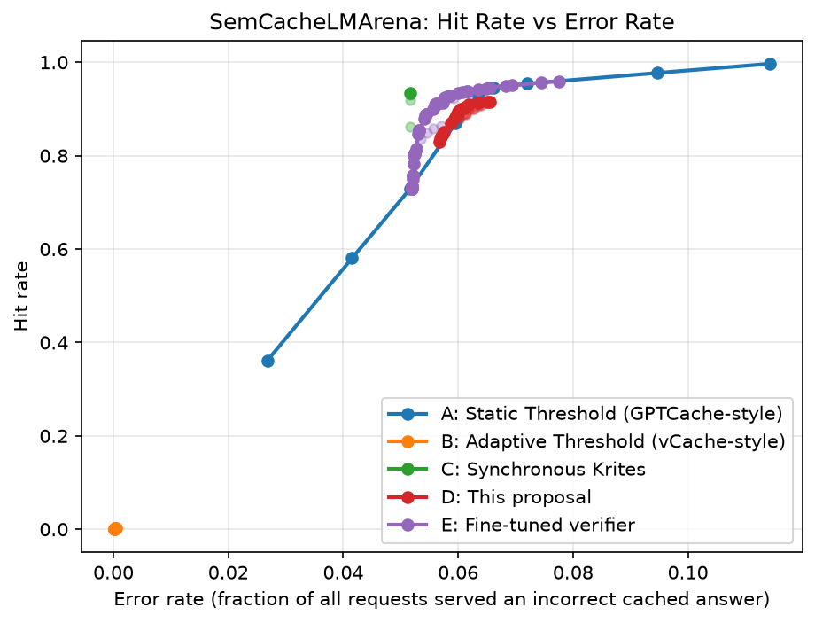

# Synchronous Online Verification Gating in Semantic Caches

**Chengyou Xin** · LoopDot AI Research · 2026-07-26

English | [简体中文](README_ZH.md)

[](https://doi.org/10.5281/zenodo.21703364)
[](https://pypi.org/project/cacheverifier/)
[](https://github.com/imxinchengyou/CacheVerifier/actions/workflows/tests.yml)

> Semantic caches reuse an LLM's past answer when a new question looks similar enough.
> Similar isn't the same as correct. This study asks whether a **real** (non-oracle)
> verifier, run **synchronously** on borderline cache hits, actually improves the
> hit-rate / error-rate trade-off. Code, configs and every reported result are here;
> the hosted version is [CacheVerifier](https://www.cacheverifier.com).



## Findings

- **The headroom is real.** A perfect (oracle) verifier lifts hit rate **+20–28 points** at matched error rate (§5.3).
- **Off the shelf, a verifier captures little of it.** Best lead about **+1.9 points** (LmArena), and it is net harmful on SearchQueries. Verdict: a **weak Go**, not a blanket yes (§5.4).
- **Fine-tuning on a dataset's own gray-zone labels is what works.** It beats the static threshold at all 18 honestly calibrated test points across three datasets (best +6.92 points, LmArena), and needs up to ~1,000 labels on the hardest dataset (§5.6–5.7).
- **It can also hurt.** On multi-year Comcast support traffic, fine-tuning turned harmful because the gray zone's positive rate drifted 5x; a change-point monitor catches it first (§5.8–5.9).
- **Risk guarantees break under shift.** A Conformal Risk Control certificate overshoots on real covariate shift; an online ACI threshold driven by randomized audits brings it back (§5.21, §5.25).
- **On real support traffic the absolute gain is small.** At a matched error rate the fine-tuned verifier serves more hits than a static threshold, GPTCache or vCache: roughly 5–13% more than a static threshold at 1–3% error. But at 2% error every method serves only about 5–9% of requests from the cache ([comparison](ENTERPRISE_COMPARISON.md)).

## Papers

| Paper | Question | DOI | Read |
|---|---|---|---|
| Part I: Core findings | Does a real verifier help, and when? | [10.5281/zenodo.22660442](https://doi.org/10.5281/zenodo.22660442) | [EN](PAPER_CORE_STANDALONE_EN.md) · [中文](PAPER_CORE_STANDALONE.md) |
| B: Finite-sample risk control | Can the error rate be certified, and what does it cost? | [10.5281/zenodo.22663725](https://doi.org/10.5281/zenodo.22663725) | [EN](PAPER_B_FORMAL_RISK_CONTROL_EN.md) · [中文](PAPER_B_FORMAL_RISK_CONTROL.md) |
| C: Adversarial robustness | What fools it, and how much does training fix? | [10.5281/zenodo.22661312](https://doi.org/10.5281/zenodo.22661312) | [EN](PAPER_C_ADVERSARIAL_ROBUSTNESS_EN.md) · [中文](PAPER_C_ADVERSARIAL_ROBUSTNESS.md) |
| D: Integration & non-stationarity | Which signals help online, and how to adapt to drift? | [10.5281/zenodo.22665785](https://doi.org/10.5281/zenodo.22665785) | [EN](PAPER_D_INTEGRATION_NONSTATIONARY_EN.md) · [中文](PAPER_D_INTEGRATION_NONSTATIONARY.md) |
| Full technical report | Every experiment in one document | [10.5281/zenodo.21703364](https://doi.org/10.5281/zenodo.21703364) | [EN](PAPER_EN.md) · [中文](PAPER.md) · [LaTeX](PAPER_EN.tex) |

**Reproduce:** `pip install -r requirements.txt && pytest tests/ -q`, then the per-dataset
configs; see [Reproducing](#reproducing). **Corrections** are published, not silently
fixed: three errata (2026-08-09, 2026-09-24, 2026-09-27) at the top of
[`PAPER_EN.md`](PAPER_EN.md), and a vCache-baseline porting fix (2026-08-17, §5.2).

## Results at a glance

| Dataset | Off-the-shelf verifier (Group D) | Domain-fine-tuned verifier (Group E) |
|---|---|---|
| LmArena (conversational) | AUC 0.72 · best net gain ≈ **+1.9pp** hit rate (grid search) · **6/6 wins**, up to **+3.10pp**, under honest calibration | AUC **0.88** · beats static-threshold frontier at nearly every tested point (grid search) · **6/6** under honest calibration, up to **+6.92pp** |
| SearchQueries (short keyword) | AUC 0.60 · **net harmful** under grid search (23/36 losses to static threshold) · **still net harmful** under honest calibration (0 wins, 1 tie, 5 losses) | AUC **0.71** · wins 53/54 tested points, 1 tie, 0 losses (grid search) · **6/6** under honest calibration, up to **+2.33pp** |
| Quora (paraphrase pairs) | — (not in original benchmark) · under honest calibration 0 wins, 3 ties, 3 losses | Smaller-magnitude replication of the same pattern; 0 losses under grid search, **6/6** under honest calibration, up to **+0.87pp** |

"Grid search" = the paper's original hand-picked threshold grid, best point reported. "Honest calibration" = a threshold chosen via Youden's J on a held-out calibration half only, then measured on the untouched test half (§5.4) — added 2026-08-15/16 specifically to test whether the grid-search numbers above were optimistic, and compared against the static threshold on exactly the same requests since the 2026-09-24 erratum (the earlier honest-calibration numbers — SearchQueries "6/6 wins, +0.78 to +3.67pp", fine-tuned +7.74pp — compared the verifier on half the gray zone against a frontier built on all requests; see the erratum at the top of [`PAPER.md`](PAPER.md)). See §5.4/§6.1 for the full account.

Oracle ceiling (upper bound on the mechanism, both benchmark datasets): **+20–28pp** hit rate at matched error rate. A separate reproduction fix for the adaptive-threshold baseline (Group B) raised its hit rate **4.4x–29.1x** across all three datasets (§5.2) — Group B sits at a different hit-rate scale and isn't part of the Go/No-Go comparison above. Full numbers, confidence intervals, and further robustness/ablation sections (noise, cold start, drift monitor, τ_high sensitivity, reranker capacity vs. training distribution, Conformal Risk Control, rewrite-vs-reject, Top-K cascade, CRC closed-loop self-selection, cost-sensitive reanalysis, LLM red-teaming, adversarial training, selective abstention, CRC validity, cached-query input, entity-swap fusion, joint decisions, Adaptive Conformal Inference) are in the paper, §5.9–§5.25.

## Core results (§5.1–5.8)

- **Group A: the static-threshold baseline (§5.1).** At a loose threshold,
  error rate is already high — 11.4% on LmArena, 34.3% on SearchQueries —
  confirming that plain similarity-threshold tuning alone cannot separate
  correct reuse from confusable near-misses (e.g. "pause" vs. "cancel").
- **Group B: adaptive threshold with a formal guarantee (§5.2).** The
  faithfully-ported vCache algorithm drives hit rate to near zero
  (0.02%–0.69%) while keeping error rate far below its target δ — a
  structural cost of requiring the same cache entry to be hit ≥6 times
  before it can be exploited. **[2026-08-17]** A porting bug (missing two
  bootstrap seed observations the official code pre-seeds) meant the
  official algorithm only needs 4, not 6; after the fix, hit rate rises
  **4.4x–29.1x** across all three datasets with the guarantee still intact.
- **Group C: the oracle ceiling (§5.3).** A perfect verifier delivers
  **+20.6pp** (LmArena) / **+27.9pp** (SearchQueries) hit rate at matched
  error rate over the static-threshold frontier — proof the mechanism has
  real headroom, independent of which verifier ends up implementing it.
- **Group D: an off-the-shelf verifier only cashes in a sliver (§5.4).**
  Best net lead is +1.9pp on LmArena (less than a tenth of the oracle
  ceiling, and 11/30 tested points do worse than the static threshold),
  and the verifier is **net harmful** on SearchQueries under the paper's
  original grid-searched threshold (23/36 losses). Under an
  honestly-calibrated threshold (Youden's J on a held-out calibration half,
  no peeking at test data), compared against the static threshold on the
  same requests, SearchQueries stays net harmful (0 wins, 1 tie, 5 losses)
  while LmArena wins 6/6. Inside the default gray zone, raw similarity
  alone ranks requests better than this off-the-shelf cross-encoder on
  SearchQueries and Quora. **[corrected 2026-09-24]** An earlier version
  said SearchQueries "reverses to 6/6 wins (+0.78pp to +3.67pp)" under
  honest calibration; that came from an evaluation-set mismatch and is
  withdrawn.
- **The latency cost of going synchronous (§5.5).** The paper's original
  70ms oracle-latency modeling assumption undershot a real measurement by
  **~24x** (1687.8ms mean, DeepSeek as a stand-in for GPT-4.1-nano) —
  later found to be mostly international-network overhead rather than
  generation time. A same-region, connection-reused, no-GPU cross-encoder
  deployment instead measures **p50 ~33ms / p95 ~44ms** full server-side
  latency — the two numbers bound the real cost depending on whether the
  gray zone is judged by an LLM or a scoring model.
- **Group E: fine-tuning closes the gap (§5.6).** Fine-tuning the same
  base verifier on a dataset's own gray-zone labels (which the online
  system already produces for free) turns LmArena's fragile result into
  one that strictly dominates the static-threshold frontier, and turns
  SearchQueries from **net harmful** into **53/54 wins, 1 tie, 0 losses**
  (+4.50pp). Replicated on a third, independently-sourced dataset (Quora
  Question Pairs): 0 losses, +2.03pp. Holds under honest calibration too —
  18/18 tested points win across the three datasets (best leads: LmArena
  +6.92pp, SearchQueries +2.33pp, Quora +0.87pp; corrected 2026-09-24).
- **Deployment robustness: noise, cold start, drift (§5.7).** The
  fine-tuning recipe tolerates up to ~30% label noise before turning
  harmful (consistent across all three datasets after a data-defect
  correction), needs up to ~1,000 in-domain examples on the hardest
  dataset before reliably helping, and shows only mild continued decay
  over time — not zero, but not alarming either.
- **A genuine production counter-example (§5.8).** On real, multi-year
  customer-support Twitter traffic (Kaggle, Axelbrooke 2017), one of two
  brands (comcastcares) shows fine-tuning turning *harmful* at every noise
  level, cold-start size, and drift distance tested — traced to a single
  monitorable cause: the gray-zone positive rate itself drifting 5x
  between the training and deployment windows, not label quality or data
  quantity. §5.9's change-point monitor catches this before it does
  damage.

## Further ablations (§5.9–§5.25)

- **Drift monitor (§5.9):** two change-point tests on gray-zone labels alone
  catch the one real-traffic counter-example's degradation before it does
  damage, with no false alarms on the unaffected brand.
- **Action-verb bucketing pre-filter (§5.10):** tested and refuted on all
  three datasets.
- **τ_high sensitivity (§5.11):** dataset-dependent — widening it more than
  triples LmArena's net lead but flips SearchQueries to a net loss.
- **Reranker capacity vs. training distribution (§5.12):** neither a
  larger same-distribution reranker nor a broader-distribution one
  meaningfully closes SearchQueries' gap — in-domain fine-tuning (§5.6)
  remains the only verified remedy.
- **Conformal Risk Control (§5.13):** upgrades the gray-zone reuse
  threshold from a point estimate to a finite-sample risk guarantee, at
  near-oracle efficiency (η≈1.0) across all three datasets.
- **Rewrite instead of reject (§5.14):** a TweakLLM-style rewrite-and-serve
  policy shows no measurable net benefit over the existing binary gate — a
  negative ablation.
- **Top-K candidate cascade (§5.15):** retrieving more than the single
  nearest neighbor is close to a free lunch on LmArena, essentially no
  effect on Quora, and a real hit-rate/error-rate trade-off on SearchQueries
  that fine-tuning mitigates but doesn't eliminate.
- **CRC closed-loop self-selection (§5.16):** a genuine online closed-loop
  test (not a static split) confirms the gate's own reuse/reject decisions
  can feed back into future cache state — harm scales monotonically with
  direct-hit rate, from no detectable effect (Quora) to more than tripling
  realized risk (LmArena); online recalibration fully compensates on two
  of three datasets but not the third.
- **Cost-sensitive reanalysis (§5.17):** reframes the hit-rate/error-rate
  frontier as an explicit cost-ratio sweep (error cost vs. miss cost) —
  once Group D/E's honest-calibration grid is extended to match Group A's
  and each operating point is compared on the same requests (corrected
  2026-09-24), synchronous verification wins economically once errors cost
  more than roughly 1.3–3.6x a miss for the fine-tuned verifier and
  3.2–12.6x for the off-the-shelf one, dataset-dependent; a grid-coverage
  gap in the first pass had produced a spurious reversal at high cost
  ratios that disappears once closed.
- **LLM automated red-teaming (§5.18):** adversarial samples generated
  across five known failure axes (negation, action-verb swap, direction
  reversal, entity swap, quantity swap) push the off-the-shelf verifier's
  false-accept rate to 84% — far above anything seen on natural data — and
  critically, the in-domain fine-tuning that fixes natural-data
  discriminative power (§5.6) provides no protection at all against these
  adversarial cases.
- **Adversarial training (§5.19):** mixing a small (3.8%), non-overlapping
  batch of adversarial training data into the existing natural fine-tuning
  set cuts the adversarial false-accept rate from 84–88% down to 53.6%
  (95% CI non-overlapping with either baseline) with no cost to natural-data
  AUC — the robustness gap §5.18 found is fixable, not a fundamental
  limitation of fine-tuning, but 53.6% is still far from solved and one
  category (named-entity swap) got worse, not better.
- **Selective abstention (§5.20, negative):** the verifier score's distance
  to its decision threshold carries no economically exploitable structure
  about whether to trust a decision — once compared against a properly
  cost-tuned single threshold instead of Youden's J, a ternary
  serve/defer/miss gate offers no incremental value over the existing
  binary gate.
- **CRC validity gate (§5.21):** Section 5.13's apparent exchangeability
  failure on Quora turns out to be a label-annotation artifact, not real
  drift; SearchQueries has a genuine covariate-shift violation, but a
  per-request validity gate can't beat periodic recalibration or a global
  conservative margin at holding the guarantee.
- **Cached-query input (§5.22):** adding the cache entry's own historical
  query to the verifier backfires under naive concatenation (a new
  surface-overlap shortcut) but works via a word-level diff summary — and
  swapping the verifier's pretraining objective to NLI on top of that closes
  most of the remaining entity_swap gap, roughly halving the average
  adversarial false-accept rate again.
- **entity_swap training-trajectory and fusion (§5.23):** the post-fine-tuning
  entity_swap regression is a decision-boundary replacement essentially
  complete within the first quarter of an epoch, not gradual erosion;
  post-hoc score fusion recovers it, but only pays off economically once a
  false-accept costs roughly 10–20x a miss.
- **Joint decisions and online adaptive thresholds (§5.24):** the similarity
  signal the gray-zone gate discards has real, causally-confirmed headroom —
  but only when the verifier's own discriminative power is weak; generalizing
  to Top-K cascades exposes cache-growth non-stationarity that no static
  threshold calibration can handle, fixed instead by switching to online
  Adaptive Conformal Inference (ACI).
- **ACI's formal guarantee (§5.25):** gives ACI's existing finite-sample
  bound a deployment-scale interpretation — a window-scale ratio computable
  before deployment — and confirms it holds distribution-free; the bound is
  worst-case, though, and doesn't predict the size of real-world advantage.

## Formal guarantees (§5.13, §5.25)

Two results in this paper are exact, distribution-free guarantees, not
point estimates or empirical trends:

- **Conformal Risk Control (§5.13; Theorem 1, Angelopoulos et al., 2024).**
  Calibrating the gray-zone reuse threshold via CRC gives a finite-sample
  guarantee that the deployed error rate does not exceed a target level,
  at any sample size — no asymptotic approximation, at near-oracle
  efficiency (η≈1.0) across all three datasets. Requires the accept rule
  to be strictly right-continuous (`score > λ`, not `≥`) and
  calibration/deployment data to be exchangeable — the second assumption
  is later shown to fail under a real chronological split on SearchQueries
  (§5.21).
- **ACI's finite-time bound (§5.25, this paper's own proposition).** For
  any sequence of scores/labels — no i.i.d. or stationarity assumption
  required, adversarial drift included — the windowed risk deviation of
  an online adaptive threshold satisfies:

  ```
  | (1/W) sum(err_s) - alpha | <= min( (theta_max-theta_min)/(W*gamma), max(alpha, 1-alpha) )
  ```

  This closes the CRC guarantee's real violation observed on
  SearchQueries (§5.13/§5.21): applying ACI online brings overall risk
  within 0.0003–0.0005 of target at all four tested α levels, versus a
  20–25% systematic overshoot for a static threshold. The bound is
  worst-case — a window-scale diagnostic derived from it (`rho = W/W*`)
  predicts only whether the bound itself is informative, *not* whether
  ACI empirically beats a static baseline; a controlled window-length
  sweep found ACI's real advantage can stay significant even where the
  bound is vacuous (`rho << 1`).

Full derivations, validity testing, and two corollaries (score-invariance;
a hit-rate ceiling governed by the ROC curve) are in §5.13 and §5.25.

## Comparison on real customer-support traffic

[`ENTERPRISE_COMPARISON.md`](ENTERPRISE_COMPARISON.md) ([中文](ENTERPRISE_COMPARISON_ZH.md)) compares CacheVerifier, vCache, a Redis static threshold and GPTCache on the same Twitter customer-support streams (AmazonHelp, comcastcares), with LLM-judge labels checked against 100 blind human labels. At a matched 1%–3% error rate the fine-tuned verifier serves about 5%–13% more hits than a static threshold and stays closest to its target error rate under time shift; absolute hit rates on this traffic are only 5%–9%.

## From this research to the product

Why [CacheVerifier](https://www.cacheverifier.com) is built as a loop rather than a one-off check:

| Finding here | What the product does about it |
|---|---|
| An off-the-shelf verifier captures little of the oracle's headroom; fine-tuning on a dataset's own gray-zone labels captures most of it | Fine-tunes a verifier on your own feedback; a free Health Check measures stock vs. fine-tuned on your traffic before you commit |
| Gains depend on the workload; on a real production counter-example, raising the threshold is the better move (§5.8) | The Health Check says so when that's your case, instead of selling you verification |
| Fine-tuning tolerates realistic label noise, but turns harmful past ~30% (§5.7) | Holds back a fine-tune whose training labels look too noisy, instead of auto-activating it |
| A calibration-time risk guarantee (CRC) overshoots under real covariate shift (§5.21); online ACI closes it (§5.25) | Randomized audits of approved hits measure the live error rate with an exact upper bound; an optional online (ACI) threshold follows the audits |
| A fine-tune's gain decays mildly over time after deployment, and real traffic can shift outright | Drift monitoring; on Managed plans, scheduled and drift-triggered recalibration on your feedback |

On top of that, for running a cache after launch: a list of cache entries your feedback
reports stale or often wrong, and local scoring with your fine-tuned model in your own
stack. Python client: [`cacheverifier`](https://github.com/imxinchengyou/cacheverifier-python)
on PyPI. Docs: <https://www.cacheverifier.com/docs>.

## Repository layout

| Path | Contents |
|---|---|
| `cacheverifier/` | Cache policies (static/adaptive/synchronous-verified), embedders, verifiers, metrics, experiment runners |
| `scripts/` | Dataset conversion, fine-tuning, drift-monitoring, and plotting scripts referenced throughout the paper |
| `configs/` | Per-dataset YAML configs (LmArena, SearchQueries, Quora, Twitter Amazon/Comcast) |
| `results/` | Every reported metric (JSON) and figure (PNG); see [`results/PRETRAINED_MODELS.md`](results/PRETRAINED_MODELS.md) for the two fine-tuned verifier checkpoints, hosted on Hugging Face rather than committed here |
| `tests/` | Unit tests for `cacheverifier/` |

## Reproducing

```bash
python3 -m venv .venv && .venv/bin/pip install -r requirements.txt
# Verifier fine-tuning / cross-encoder experiments need the heavier deps:
.venv/bin/pip install -r requirements-embeddings.txt

.venv/bin/pytest tests/ -q
```

Datasets are not redistributed in this repo (see `data/` in `.gitignore`) —
`scripts/convert_*.py` regenerate them from the public sources cited in the
paper's §4.1 (HuggingFace `vCache/SemBenchmarkLmArena` / `SemBenchmarkSearchQueries`,
Quora Question Pairs, the Twitter Customer Support corpus). Each `configs/*.yaml`
then drives `cacheverifier/experiments/run_baselines.py` (Groups A/B) and
`run_verified.py` (Groups C/D) for that dataset.

## Fine-tuned models

The Group E fine-tuned verifiers are on the Hugging Face Hub, not in this
repo — see [`results/PRETRAINED_MODELS.md`](results/PRETRAINED_MODELS.md).

## Citation

Archived on Zenodo with DOI [10.5281/zenodo.21703364](https://doi.org/10.5281/zenodo.21703364)
(this concept DOI always resolves to the latest version; DOIs for individual versions are listed on the [Zenodo record](https://doi.org/10.5281/zenodo.21703364) under "Versions").
arXiv listing forthcoming — this will be updated with the arXiv ID once live.

```bibtex
@misc{xin2026synchronous,
  title  = {Synchronous Online Verification Gating in Semantic Caches: An Empirical Study},
  author = {Xin, Chengyou},
  year   = {2026},
  note   = {LoopDot AI Research},
  url    = {https://github.com/imxinchengyou/CacheVerifier},
  doi    = {10.5281/zenodo.21703364}
}
```

## Acknowledgments

Groups A/B of this work build directly on public benchmarks and reference
code from the **vCache** project (L. G. Schroeder, A. Desai, A. Cuadron,
K. Chu, S. Liu, M. Zhao, S. Krusche, A. Kemper, I. Stoica, M. Zaharia, and
J. E. Gonzalez) — the SemCacheLmArena/SemCacheSearchQueries datasets, the
static-threshold grid, and the `VerifiedDecisionPolicy` this paper ports
line-by-line. Sections 5.6 and 5.8 further build on **Quora Question
Pairs** (Iyer, Dandekar, & Csernai, 2017) and the Kaggle **"Customer
Support on Twitter"** dataset (Axelbrooke, 2017). See the paper's own
Acknowledgments section for the full note.

## Third-party data

The experiments use third-party datasets that remain under their own terms;
nothing in this repository's `LICENSE` applies to them:

| Dataset | Source | License / terms |
|---|---|---|
| SemCacheLmArena, SemCacheSearchQueries | Hugging Face `vCache/SemBenchmarkLmArena`, `vCache/SemBenchmarkSearchQueries` | Apache-2.0 (per the dataset cards) |
| Quora Question Pairs | Quora's first public dataset release (Iyer, Dandekar, & Csernai, 2017) | Quora's release terms |
| Customer Support on Twitter | Kaggle `thoughtvector/customer-support-on-twitter` (Axelbrooke, 2017) | [CC BY-NC-SA 4.0](https://creativecommons.org/licenses/by-nc-sa/4.0/); the dataset page asks that commercial use be arranged with the author |

Tweet text from the Twitter corpus is not included in this repository. The
`results/` files for the AmazonHelp and comcastcares experiments contain only
aggregate numbers; to rerun the experiments that read per-example text
(e.g. `scripts/aci_real_production_drift_score.py --stash ...`), regenerate
the data with `scripts/convert_twitter_cs_dataset.py` from your own download
of the Kaggle dataset under its license, then rerun
`scripts/finetune_verifier_experiment.py` to write the `.examples.json` stash.

## License

**All rights reserved** — see [`LICENSE`](LICENSE). This repository is
public to support reproducibility of the paper's reported results; no
license is granted for reuse, modification, or redistribution. This covers
the authors' own code and text only; third-party datasets keep their own
licenses (see "Third-party data" above).