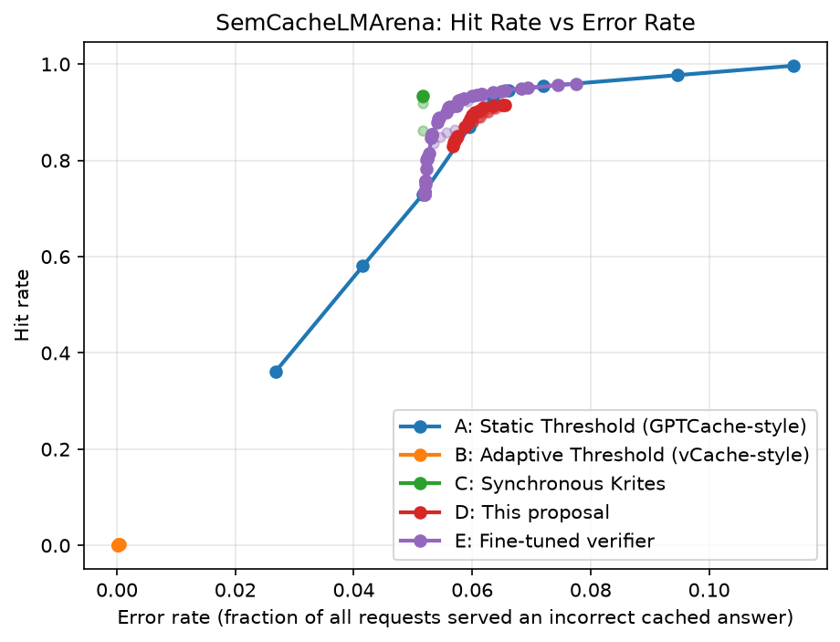

# 语义缓存中的同步在线验证门禁

**Chengyou Xin** · LoopDot AI Research · 2026-07-26

[English](README.md) | 简体中文

[](https://doi.org/10.5281/zenodo.21703364)
[](https://pypi.org/project/cacheverifier/)
[](https://github.com/imxinchengyou/CacheVerifier/actions/workflows/tests.yml)

> 语义缓存在新问题"看起来足够相似"时复用大模型的历史回答,但相似不等于正确。本研究的问题是:
> 一个**真实**(非 oracle)的验证器,**同步**地只对边界命中做判断,能不能真正改善命中率与错误率之间的权衡?
> 代码、配置和全部实验结果都在这里;托管版本是 [CacheVerifier](https://www.cacheverifier.com)。



## 主要发现

- **理论空间确实存在。** 完美(oracle)验证器在相同错误率下把命中率提升 **20~28 个百分点**(§5.3)。
- **现成验证器只拿到其中很小一部分。** 最好时约 **+1.9 个百分点**(LmArena),在 SearchQueries 上反而净损害。结论是**弱 Go**,不是无条件成立(§5.4)。
- **真正起作用的是用数据集自己的灰区标签微调。** 诚实校准下,三个数据集共 18 个测试点全部跑赢静态阈值(最好 +6.92 个百分点,LmArena);最难的数据集需要约 1,000 条标签(§5.6–5.7)。
- **微调也可能有害。** 在多年的 Comcast 客服流量上,灰区正例比例漂移了 5 倍,微调变成了负收益;变点监控能提前发现(§5.8–5.9)。
- **风险保证在分布偏移下会被突破。** Conformal Risk Control 证书在真实协变量偏移下超标;由随机抽检驱动的在线 ACI 阈值能把它拉回来(§5.21、§5.25)。
- **在真实客服流量上,绝对收益很小。** 在同一错误率下,微调验证器比静态阈值、GPTCache、vCache 命中都多,1%–3% 错误率下比静态阈值多命中约 6%–15%(相对值)。但 2% 错误率下,所有方法都只有约 5%–9% 的请求能从缓存返回([对比](ENTERPRISE_COMPARISON_ZH.md))。

## 论文

| 论文 | 研究问题 | DOI | 阅读 |
|---|---|---|---|
| 第一部分:核心发现 | 真实验证器有没有用、什么时候有用? | [10.5281/zenodo.22660442](https://doi.org/10.5281/zenodo.22660442) | [中文](PAPER_CORE_STANDALONE.md) · [EN](PAPER_CORE_STANDALONE_EN.md) |
| B:有限样本风险控制 | 错误率能不能被认证,代价是什么? | [10.5281/zenodo.22663725](https://doi.org/10.5281/zenodo.22663725) | [中文](PAPER_B_FORMAL_RISK_CONTROL.md) · [EN](PAPER_B_FORMAL_RISK_CONTROL_EN.md) |
| C:对抗鲁棒性 | 什么能骗过它,训练能补上多少? | [10.5281/zenodo.22661312](https://doi.org/10.5281/zenodo.22661312) | [中文](PAPER_C_ADVERSARIAL_ROBUSTNESS.md) · [EN](PAPER_C_ADVERSARIAL_ROBUSTNESS_EN.md) |
| D:整合与非平稳性 | 哪些信号在线上有用,如何适应漂移? | [10.5281/zenodo.22665785](https://doi.org/10.5281/zenodo.22665785) | [中文](PAPER_D_INTEGRATION_NONSTATIONARY.md) · [EN](PAPER_D_INTEGRATION_NONSTATIONARY_EN.md) |
| 完整技术报告 | 全部实验合在一份文档里 | [10.5281/zenodo.21703364](https://doi.org/10.5281/zenodo.21703364) | [中文](PAPER.md) · [EN](PAPER_EN.md) · [LaTeX](PAPER_EN.tex) |

**复现:** `pip install -r requirements.txt && pytest tests/ -q`,然后按各数据集的配置运行,见[复现步骤](#复现步骤)。
**勘误**公开发布,不悄悄修改:[`PAPER.md`](PAPER.md) 文首有三条勘误(2026-08-09、2026-09-24、2026-09-27),vCache 基线移植修复(2026-08-17)见 §5.2。

## 结果速览

| 数据集 | 开箱即用验证器(Group D) | 领域内微调验证器(Group E) |
|---|---|---|
| LmArena(对话式) | AUC 0.72 · 网格搜索下最佳净收益约 **+1.9 个百分点**命中率 · 诚实校准下 **6/6 全赢**,最高 **+3.10 个百分点** | AUC **0.88** · 网格搜索下几乎在所有测试点上跑赢静态阈值前沿 · 诚实校准下 **6/6**,最高 **+6.92 个百分点** |
| SearchQueries(短关键词) | AUC 0.60 · 网格搜索下**净损害**(36个测试点中23个输给静态阈值) · 诚实校准下**仍是净损害**(0 胜 1 平 5 负) | AUC **0.71** · 网格搜索下 54 个测试点中 53 个跑赢,1个打平,零落后 · 诚实校准下 **6/6**,最高 **+2.33 个百分点** |
| Quora(复述问题对) | —(不在原始 benchmark 内) · 诚实校准下 0 胜 3 平 3 负 | 以更小幅度复现同样的模式;网格搜索下零落后,诚实校准下 **6/6**,最高 **+0.87 个百分点** |

"网格搜索"指本文最初手选阈值网格、报告其中最优点的方式。"诚实校准"指把灰色地带样本按时间顺序切成校准集/测试集,阈值只在校准集上用 Youden's J 选取,再在完全没参与选阈值的测试集上测量(见 §5.4)——这是 2026-08-15/16 追加的,专门用来检验上面网格搜索的数字是不是偏乐观;自 2026-09-24 勘误起,改为与静态阈值在完全相同的一批请求上比较(此前的诚实校准数字——SearchQueries"6/6 全赢,+0.78~+3.67 个百分点"、微调后 +7.74 个百分点——是把验证器在一半灰区上的结果和建立在全部请求上的前沿比较得到的,见 [`PAPER.md`](PAPER.md) 文首勘误)。完整说明见 §5.4/§6.1。

Oracle 理论上限(机制本身的上界,两个基准数据集均适用):相同错误率下命中率 **+20~28 个百分点**。另外,自适应阈值基线(Group B)的一处复现修复让其命中率在三个数据集上提升了 **4.4~29.1 倍**(见 §5.2)——Group B 命中率量级完全不同,不参与上面的 Go/No-Go 对比。完整数字、置信区间,以及更多稳健性/消融实验(噪声、冷启动、漂移监控、τ_high 敏感性、reranker 容量与训练分布对比、Conformal Risk Control、"改写代替拒绝"、Top-K 候选级联、CRC 闭环自选择、成本敏感重分析、LLM 红队测试、对抗训练、选择性弃权、CRC 校验性门禁、缓存查询输入、entity_swap 融合、联合决策、Adaptive Conformal Inference),见论文 §5.9–§5.25。

## 核心结果(§5.1–5.8)

- **Group A:静态阈值基线(§5.1)。** 即便阈值放得很松,错误率也已经不低——LmArena 上 11.4%,SearchQueries 上 34.3%——说明单纯调相似度阈值本身就没法把"确实该复用"和"表面像但答案不同"(比如"暂停"vs"取消")分开。
- **Group B:带正式保证的自适应阈值(§5.2)。** 逐行复刻的 vCache 算法把命中率压到接近零(0.02%~0.69%),同时把错误率控制在目标 δ 之下很多——代价是结构性的:同一个缓存条目必须被命中 ≥6 次才能被利用。**【2026-08-17】** 一处复刻 bug(漏掉了官方代码预置的两条 bootstrap 观测)导致本文早期版本需要 6 次而官方只需要 4 次;修复后,三个数据集的命中率均提升 **4.4~29.1 倍**,保证依旧成立。
- **Group C:oracle 理论上限(§5.3)。** 一个完美验证器在相同错误率下,相比静态阈值前沿能带来 **LmArena +20.6 个百分点** / **SearchQueries +27.9 个百分点** 的命中率提升——证明这套机制确实有理论空间,与最终用哪个验证器实现无关。
- **Group D:现成验证器只兑现了一小片(§5.4)。** LmArena 上最佳净收益仅 +1.9 个百分点(不到 oracle 上限的十分之一,且 30 个测试点里有 11 个反而比静态阈值差),SearchQueries 上按本文最初的网格搜索阈值算,验证器**净损害**(36 个测试点里 23 个输)。换成诚实校准的阈值(在留出的校准集上用 Youden's J 选取,不偷看测试集)、并在同一批请求上与静态阈值比较后,SearchQueries 仍然是净损害(0 胜 1 平 5 负),LmArena 6/6 全赢;在默认灰区内部,原始相似度本身的排序在 SearchQueries 和 Quora 上都优于这个现成交叉编码器。**【2026-09-24 更正】** 早期版本曾说 SearchQueries 在诚实校准下"反转为 6/6 全赢(+0.78~+3.67 个百分点)",那是评估集合不一致造成的,已撤回。
- **同步化的延迟代价(§5.5)。** 论文最初假设的 oracle 延迟(70ms)比实测低了约 **24 倍**(实测均值 1687.8ms,用 DeepSeek 代替无法访问的 GPT-4.1-nano)——后来发现这个数字大部分是国际网络链路开销,不是生成耗时本身。同机房、复用连接、无 GPU 的 cross-encoder 部署实测服务端全链路延迟为 **p50 ~33ms / p95 ~44ms**——真实代价取决于灰色地带是交给 LLM 判定还是打分模型判定,落在这两个数字之间。
- **Group E:微调补上差距(§5.6)。** 用数据集自己的灰色地带标签(在线系统本来就免费产生这些标签)微调同一个基础验证器,能把 LmArena 上脆弱的结果变成严格优于静态阈值前沿,把 SearchQueries 从**净损害**变成 **54 个测试点中 53 个赢、1 个平、零落后**(+4.50 个百分点)。在第三个、独立来源的数据集(Quora Question Pairs)上复现:零落后,+2.03 个百分点。诚实校准下同样成立——三个数据集共 18 个测试点全部跑赢(最佳领先:LmArena +6.92、SearchQueries +2.33、Quora +0.87 个百分点;2026-09-24 更正)。
- **部署稳健性:噪声、冷启动、漂移(§5.7)。** 这套微调方案能容忍最多约 30% 的标签噪声才会转为有害(修正数据缺陷后三个数据集表现一致),最难的数据集上需要约 1,000 条领域内样本才能可靠起效,随时间推移只有轻微但真实存在的持续衰减——不是零衰减,但也不算严重。
- **一个真实的生产反例(§5.8)。** 在真实的、跨越数年的客服 Twitter 流量上(Kaggle,Axelbrooke 2017),两个品牌中有一个(comcastcares)在所测的每一档噪声水平、每一档冷启动规模、每一个漂移距离上,微调都变成了**有害**的——追溯到一个具体、可监控的原因:灰色地带正例率本身在训练窗口和部署窗口之间漂移了 5 倍,不是标签质量或数据量的问题。§5.9 的变点监控能在这种情况真正造成损害之前就发现它。

## 更多消融实验(§5.9–§5.25)

- **漂移监控(§5.9)**:仅用灰色地带标签跑两种经典的变点检测,能在真实流量反例真正造成损害之前就发出预警,同时在没问题的品牌上不误报。
- **动词分桶预筛选(§5.10)**:在三个数据集上都测试并证伪了。
- **τ_high 敏感性(§5.11)**:效果因数据集而异——放宽阈值能让 LmArena 的净收益翻两倍多,但同样的调整会让 SearchQueries 由正转负。
- **reranker 容量与训练分布对比(§5.12)**:无论是换成同分布、容量更大的 reranker,还是训练分布更广、同样更大的 reranker,都没能明显缩小 SearchQueries 的差距——领域内微调(§5.6)仍是目前唯一验证有效的办法。
- **Conformal Risk Control(§5.13)**:把灰色地带复用阈值从一个点估计升级为有限样本下的风险保证,三个数据集上的效率都接近 oracle(η≈1.0)。
- **改写代替拒绝(§5.14)**:仿照 TweakLLM 思路,拒绝后不直接放弃而是改写后照样服务,测下来相比现有的二元门禁没有可测出的净收益——一个负面消融结果。
- **Top-K 候选级联(§5.15)**:不只检索单一最近邻,在 LmArena 上接近免费收益,在 Quora 上几乎无效果,在 SearchQueries 上存在真实的 hit_rate/error_rate 权衡,微调能缓解但不能根除。
- **CRC 闭环自选择(§5.16)**:一次真正的在线闭环测试(而非静态切分)证实门禁自身的复用/拒绝决策确实会反过来塑造未来缓存状态——伤害幅度和直接命中率呈单调关系,从测不出效应(Quora)到风险翻三倍以上(LmArena);在线重新校准能在三个数据集里两个上完全补偿,第三个上补不完。
- **成本敏感重分析(§5.17)**:把命中率-错误率前沿换成显式的成本比扫描(错误代价 vs. miss 代价)——把 Group D/E 诚实校准的网格补齐到和 Group A 一致、并让每个操作点都在同一批请求上比较后(2026-09-24 更正),同步验证机制在错误代价明显高于 miss 代价时经济上胜出——微调验证器通常约 1.3–3.6 倍、现成验证器约 3.2–12.6 倍,视数据集而定;初版结果曾在高代价比区间出现一个反转,补齐网格覆盖后确认是伪影。
- **LLM 自动化红队测试(§5.18)**:用覆盖五个已知失效轴(否定、动作词替换、方向反转、实体替换、数量替换)的对抗样本测试,把现成验证器的错误通过率推到 84%——远高于自然数据上测出的任何数字;更关键的是,能修补自然数据判别力的领域内微调(§5.6),对这些对抗样本完全没有起到保护作用。
- **对抗训练(§5.19)**:把一小批(仅占 3.8%)、和留出测试集互不重叠的对抗训练数据混进已有的自然微调训练集,能把对抗错误通过率从 84–88% 降到 53.6%(置信区间和另外两个都不重叠),且不牺牲自然数据 AUC——§5.18 发现的鲁棒性缺口是可以补上的,不是微调机制的根本局限,但 53.6% 仍远未解决问题,且命名实体替换这一个类别训练后反而变差。
- **选择性弃权(§5.20,负面结果)**:验证器分数到决策阈值的距离,不携带关于"这次判定该不该信任自己"的、可经济利用的结构化信息——一旦把基线从 Youden's J 换成一个已经按成本比调好的单阈值,"服务/弃权/放弃"三元门禁相比现有二元门禁没有增量价值。
- **CRC 校验性门禁(§5.21)**:§5.13 在 Quora 上看似发现的 exchangeability 违规,其实是标注批次的伪影,不是真实漂移;SearchQueries 有真实的协变量漂移,但逐请求校验性门禁在维持保证这件事上,并不比定期重新校准或一个全局保守边际更好。
- **缓存查询输入(§5.22)**:把缓存条目自己的历史查询加进验证器,直接拼接原文会反而更差(引入新的表面重叠捷径),但换成词级 diff 摘要就有效——在此基础上把验证器的预训练目标换成 NLI,能补上大部分剩余的 entity_swap 差距,把三数据集平均对抗错误通过率再砍掉一半以上。
- **entity_swap 训练轨迹与融合(§5.23)**:微调后 entity_swap 变差的真正原因,是决策边界在训练的前四分之一个 epoch 内就基本替换完成,不是随训练逐渐侵蚀;事后分数融合能挽回这个损失,但只有在错误接受的代价大约是 miss 代价的 10~20 倍以上时才经济上划算。
- **联合决策与在线自适应阈值(§5.24)**:门禁架构一直丢弃的相似度信号确实有真实的、经因果实验证实的空间——但只在验证器自身判别力弱的时候才打开;把原理推广到 Top-K 级联后,暴露出缓存增长带来的非平稳性,任何静态阈值校准都处理不了,解法是换成在线的 Adaptive Conformal Inference(ACI)。
- **ACI 的有限样本保证(§5.25)**:给 ACI 已有的有限样本上界一个部署尺度的解读——一个部署前就能算出来的窗口尺度比值——并证实这个界是无分布假设的;但这个界是最坏情况上界,不能预测真实收益的大小。

## 正式保证(§5.13、§5.25)

本文有两处结果是精确的、无分布假设的正式保证,不是点估计或经验趋势:

- **Conformal Risk Control(§5.13;Theorem 1,Angelopoulos et al., 2024)。** 用 CRC 校准灰色地带复用阈值,能得到一个有限样本保证:部署后的错误率不会超过目标水平,在任意样本量下都成立——不依赖渐近近似,且三个数据集上的效率都接近 oracle(η≈1.0)。前提是接受规则必须严格右连续(`score > λ`,不是 `≥`),且校准数据和部署数据必须可交换——第二条假设后来在 SearchQueries 的真实时间顺序切分下被证明会失效(§5.21)。
- **ACI 的有限时间界(§5.25,本文自己的命题)。** 对任意分数/标签序列——不需要 i.i.d. 或平稳性假设,对抗性漂移也涵盖在内——在线自适应阈值的窗口风险偏差满足:

  ```
  | (1/W) sum(err_s) - alpha | <= min( (theta_max-theta_min)/(W*gamma), max(alpha, 1-alpha) )
  ```

  这个界修复了 SearchQueries 上 CRC 保证的真实违规(§5.13/§5.21):在线应用 ACI 后,四个测试的 α 水平下,整体风险与目标的偏差都收窄到 0.0003~0.0005 以内,而静态阈值会系统性超标 20%~25%。这个界是最坏情况上界——由它推出的窗口尺度诊断量(`rho = W/W*`)只能判断这个理论界本身是否还有信息量,**不能**判断 ACI 实际上是否跑赢静态基线;一次受控的窗口长度扫描发现,即便在界本身近乎失效的区域(`rho << 1`),ACI 的真实优势依然可以显著存在。

完整推导、有效性检验,以及两条推论(score-invariance;由 ROC 曲线决定的命中率上限)见论文 §5.13 和 §5.25。

## 真实客服流量上的对比

[`ENTERPRISE_COMPARISON_ZH.md`](ENTERPRISE_COMPARISON_ZH.md)([English](ENTERPRISE_COMPARISON.md))在同一批推特客服请求流(AmazonHelp、comcastcares)上比较 CacheVerifier、vCache、Redis 静态阈值和 GPTCache,LLM 判官标签用 100 条人工盲标核对过。在 1%–3% 的同一错误率下,微调后的验证器比静态阈值多命中约 6%–15%,并且在时间漂移下最接近目标错误率;这类流量的绝对命中率只有 5%–9%。

## 从研究到产品

[CacheVerifier](https://www.cacheverifier.com) 做成持续闭环、而不是一次性检查,原因如下:

| 本研究的发现 | 产品怎么应对 |
|---|---|
| 开箱即用的验证器只拿到 oracle 余量的一小部分;在数据集自己的灰区标签上微调能拿到大部分 | 用你自己的反馈微调验证器;免费的 Health Check 先在你的流量上对比现成模型和微调后的效果,再决定要不要用 |
| 收益取决于具体负载;在一个真实生产反例上,直接调高阈值反而更好(§5.8) | 你属于这种情况时,Health Check 会直接告诉你,而不是硬推验证 |
| 微调能容忍现实中的标签噪声,但超过约 30% 会起反作用(§5.7) | 训练标签噪声看起来过高的微调结果会被扣下待审,不会自动上线 |
| 校准时给出的风险保证(CRC)在真实的协变量偏移下会被突破(§5.21);在线 ACI 能把它拉回来(§5.25) | 对已放行的命中做随机抽检,给出线上错误率的精确上界;可选的在线(ACI)阈值跟随抽检结果调整 |
| 微调的收益上线后会随时间轻微衰减,真实流量也可能整体偏移 | 漂移监控;Managed 套餐按计划、并在检测到漂移时用你的反馈重新校准 |

在此之上,还有上线后运维缓存需要的东西:列出被反馈报告为过期或经常答错的缓存条目,以及在你自己的系统里用微调模型本地打分。Python 客户端:PyPI 上的 [`cacheverifier`](https://github.com/imxinchengyou/cacheverifier-python)。文档:<https://www.cacheverifier.com/docs>。

## 仓库结构

| 路径 | 内容 |
|---|---|
| `cacheverifier/` | 缓存策略(静态/自适应/同步验证)、embedding 模型、验证器、指标、实验运行器 |
| `scripts/` | 论文中提到的数据集转换、微调、漂移监控、绘图脚本 |
| `configs/` | 各数据集的 YAML 配置(LmArena、SearchQueries、Quora、Twitter Amazon/Comcast) |
| `results/` | 论文里报告的全部指标(JSON)和图表(PNG);两个微调验证器 checkpoint 托管在 Hugging Face,没有直接放进这个仓库,见 [`results/PRETRAINED_MODELS.md`](results/PRETRAINED_MODELS.md) |
| `tests/` | `cacheverifier/` 的单元测试 |

## 复现步骤

```bash
python3 -m venv .venv && .venv/bin/pip install -r requirements.txt
# 验证器微调 / cross-encoder 实验需要更重的依赖:
.venv/bin/pip install -r requirements-embeddings.txt

.venv/bin/pytest tests/ -q
```

原始数据集没有直接放进这个仓库(见 `.gitignore` 里的 `data/`)——`scripts/convert_*.py` 会从论文 §4.1 引用的公开数据源(HuggingFace `vCache/SemBenchmarkLmArena` / `SemBenchmarkSearchQueries`、Quora Question Pairs、Twitter 客服语料)重新生成。之后每个 `configs/*.yaml` 驱动 `cacheverifier/experiments/run_baselines.py`(A/B 组)和 `run_verified.py`(C/D 组)跑对应数据集。

## 微调模型

Group E 的微调验证器托管在 Hugging Face Hub,不在这个仓库里——见 [`results/PRETRAINED_MODELS.md`](results/PRETRAINED_MODELS.md)。

## 引用

已经在 Zenodo 存档,概念 DOI(始终指向最新版本): [10.5281/zenodo.21703364](https://doi.org/10.5281/zenodo.21703364)
(各个版本的 DOI 列在 [Zenodo 记录页](https://doi.org/10.5281/zenodo.21703364) 的 "Versions" 一栏)。arXiv 链接即将发布,届时会更新这里的引用信息。

```bibtex
@misc{xin2026synchronous,
  title  = {Synchronous Online Verification Gating in Semantic Caches: An Empirical Study},
  author = {Xin, Chengyou},
  year   = {2026},
  note   = {LoopDot AI Research},
  url    = {https://github.com/imxinchengyou/CacheVerifier},
  doi    = {10.5281/zenodo.21703364}
}
```

## 致谢

Group A/B 直接建立在 **vCache** 项目(L. G. Schroeder、A. Desai、A. Cuadron、K. Chu、S. Liu、M. Zhao、S. Krusche、A. Kemper、I. Stoica、M. Zaharia、J. E. Gonzalez)公开的 benchmark 和参考代码之上——SemCacheLmArena/SemCacheSearchQueries 数据集、静态阈值网格,以及本文逐行复刻的 `VerifiedDecisionPolicy`。5.6 节和 5.8 节还直接建立在 **Quora Question Pairs**(Iyer, Dandekar, & Csernai, 2017)和 Kaggle **"Customer Support on Twitter"**(Axelbrooke, 2017)数据集之上。完整致谢见论文正文。

## 第三方数据

实验用到的第三方数据集仍适用各自的条款,本仓库的许可不适用于它们:

| 数据集 | 来源 | 许可 / 条款 |
|---|---|---|
| SemCacheLmArena、SemCacheSearchQueries | Hugging Face `vCache/SemBenchmarkLmArena`、`vCache/SemBenchmarkSearchQueries` | Apache-2.0(以数据集卡片为准) |
| Quora Question Pairs | Quora 首个公开数据集(Iyer, Dandekar, & Csernai, 2017) | Quora 发布时的条款 |
| Customer Support on Twitter | Kaggle `thoughtvector/customer-support-on-twitter`(Axelbrooke, 2017) | [CC BY-NC-SA 4.0](https://creativecommons.org/licenses/by-nc-sa/4.0/);数据集页面要求商业用途需与作者联系 |

本仓库不包含 Twitter 语料中的推文原文。`results/` 中 AmazonHelp 和 comcastcares 实验的文件只有汇总数字;如需重跑读取逐条文本的实验(例如 `scripts/aci_real_production_drift_score.py --stash ...`),请自行按其许可下载 Kaggle 数据集,用 `scripts/convert_twitter_cs_dataset.py` 转换后,再运行 `scripts/finetune_verifier_experiment.py` 生成 `.examples.json` 文件。

## 许可

- **代码**(`cacheverifier/`、`scripts/`、`tests/`、`configs/`):[Apache-2.0](LICENSE)。
- **论文、文档、图表和结果**(`PAPER*`、`ENTERPRISE_COMPARISON*`、`README*`、`results/`):[CC BY 4.0](LICENSE-CC-BY-4.0)。可以自由转载和改编,包括商业用途,注明出处即可;引用时请引用论文(见"引用")。
- **不在许可范围内:** 第三方数据集以及 `results/` 中引用的第三方文本仍适用各自的条款(见上文"第三方数据");Hugging Face 上的微调模型不在本仓库的许可范围内(见 [`results/PRETRAINED_MODELS.md`](results/PRETRAINED_MODELS.md))。

2026-11-07 之前发布的版本适用"保留所有权利"条款。详见 [`NOTICE`](NOTICE)。